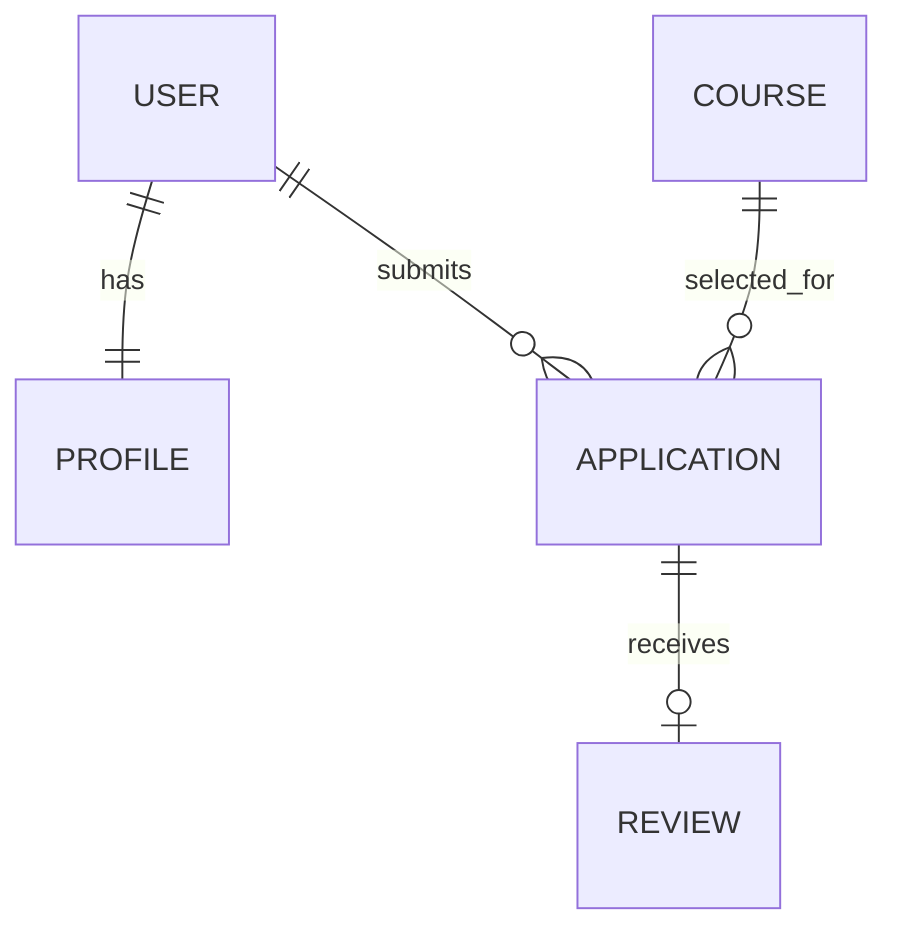

# Корочки.есть

Сайт для записи на онлайн-курсы. Пользователь может выбрать курс, подать заявку и посмотреть её статус. Администратор просматривает заявки и меняет статусы.

Проект сделан на React, Django и MySQL. Есть регистрация, поиск курсов, отзывы после завершения обучения и уведомление о cookie.

## Запуск на Windows

Нужны Python 3.13, Node.js 22 и MySQL 8.

1. Установить зависимости:

   ```powershell
   python -m venv .venv
   .\.venv\Scripts\python.exe -m pip install -r requirements.txt
   npm.cmd ci
   ```

2. Выполнить `database/setup.sql` в MySQL Workbench, заменив примерные пароли. Скопировать `.env.example` в `.env` и указать данные для подключения к базе. Для `DATA_ENCRYPTION_KEY` создать ключ командой:

   ```powershell
   .\.venv\Scripts\python.exe -c "from cryptography.fernet import Fernet; print(Fernet.generate_key().decode())"
   ```

   Также заменить `DJANGO_SECRET_KEY`, `ADMIN_LOGIN` и `ADMIN_PASSWORD`. Файл `.env` не добавляется в Git.

3. Подготовить базу и собрать сайт:

   ```powershell
   powershell -ExecutionPolicy Bypass -File scripts/start.ps1 migrate
   powershell -ExecutionPolicy Bypass -File scripts/start.ps1 create_portal_admin
   npm.cmd run build
   ```

   Администратора достаточно создать один раз.

4. Запустить сайт:

   ```powershell
   powershell -ExecutionPolicy Bypass -File scripts/start.ps1
   ```

   Адрес: http://127.0.0.1:8765/

## Проверка

```powershell
powershell -ExecutionPolicy Bypass -File scripts/start.ps1 check
powershell -ExecutionPolicy Bypass -File scripts/start.ps1 smoke_test
npm.cmd run build
```

`smoke_test` проверяет основные действия на MySQL и откатывает созданные тестовые записи. Тесты Django можно запустить отдельно с переменной `DJANGO_TEST_SQLITE=1`.

## Данные



Личные данные в профиле шифруются, пароли хранятся в виде хешей. При размещении сайта в интернете нужны HTTPS, собственные значения `DJANGO_ALLOWED_HOSTS` и `CSRF_TRUSTED_ORIGINS`, а также резервное копирование MySQL.
