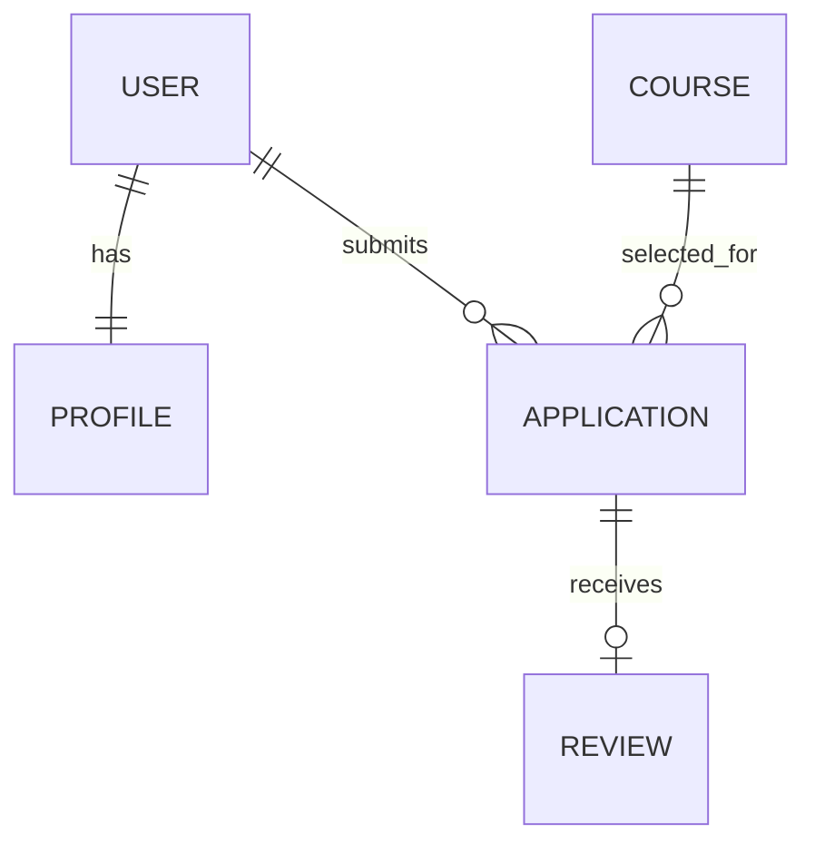

# Корочки.есть

Учебный портал записи на онлайн-курсы. Клиент: React 19 и Vite 7. Сервер: Django 5.2, сессии и CSRF. Основная база: MySQL 8. Код рассчитан на локальный запуск по HTTP и на развёртывание за HTTPS-прокси.

## Возможности

- Каталог из трёх курсов, буквальный поиск без регулярных выражений и слайдер из четырёх локальных SVG (смена каждые 3 секунды, ручное управление, учёт `prefers-reduced-motion`).
- Регистрация с согласием, вход/выход, проверка данных на сервере, заявки и собственный список заявок.
- Панель администратора: фильтр, по 10 заявок на страницу и переходы «Новая» → «Идет обучение» → «Обучение завершено».
- После пяти ошибочных попыток входа сочетание IP и логина блокируется на 15 минут.
- Один отзыв с оценкой 1–5 после завершения обучения.
- Уведомление о необходимых cookie и страницы о персональных данных и cookie.

## Быстрый запуск на Windows

1. Создайте виртуальное окружение: `python -m venv .venv`.
2. Установите серверные зависимости: `.\.venv\Scripts\python.exe -m pip install -r requirements.txt`.
3. Установите клиентские зависимости: `npm.cmd ci`.
4. Скопируйте `.env.example` в `.env`. Задайте уникальный `DJANGO_SECRET_KEY`, `DATA_ENCRYPTION_KEY` (команда ниже), пароль и параметры MySQL. Файл `.env` исключён из Git.
5. В MySQL создайте базу и сервисную учётную запись по `database/setup.sql`, заменив шаблонные пароли. Пароль сервисной учётной записи должен совпадать с `DB_PASSWORD`.
6. Выполните `powershell -ExecutionPolicy Bypass -File scripts/start.ps1 migrate`. Скрипт загружает переменные из `.env`.
7. Задайте в `.env` уникальные `ADMIN_LOGIN` и `ADMIN_PASSWORD`, затем выполните `powershell -ExecutionPolicy Bypass -File scripts/start.ps1 create_portal_admin`. В текущем локальном стенде они уже сгенерированы в `.env`, а администратор создан.
8. Соберите клиент: `npm.cmd run build`. Запустите `powershell -ExecutionPolicy Bypass -File scripts/start.ps1` и откройте `http://127.0.0.1:8765`.

Ключ шифрования можно создать командой:

```powershell
.\.venv\Scripts\python.exe -c "from cryptography.fernet import Fernet; print(Fernet.generate_key().decode())"
```

Для разработки клиент можно запустить отдельной командой `npm.cmd run dev` на `http://127.0.0.1:5173`; запросы `/api` идут в локальный Django. Для быстрой проверки без MySQL предусмотрен только тестовый режим `DJANGO_TEST_SQLITE=1` (база `test.sqlite3`). Рабочая конфигурация всегда использует MySQL.
Если у вас уже создана локальная `.env` с `DJANGO_TEST_SQLITE=1`, удалите эту строку перед проверкой на MySQL и добавьте `DB_NAME`, `DB_USER`, `DB_PASSWORD`, `DB_HOST`, `DB_PORT` из `.env.example`.

## Проверка

Для проверки основного подключения к MySQL:

```powershell
powershell -ExecutionPolicy Bypass -File scripts/start.ps1 check
powershell -ExecutionPolicy Bypass -File scripts/start.ps1 smoke_test
npm.cmd audit
npm.cmd run build
```

`smoke_test` проверяет регистрацию, вход, заявку, оба перехода статуса и отзыв на MySQL, затем откатывает тестовые записи. Модульные тесты выполняются на временной базе с `DJANGO_TEST_SQLITE=1` и проверяют валидацию, CSRF, шифрование, права доступа и блокировку входа. Для их запуска нужно временно установить эту переменную окружения только для процесса тестирования.

## Защита и эксплуатация

Сервер выдаёт CSP, `X-Frame-Options`, `X-Content-Type-Options`, `Referrer-Policy`, `Permissions-Policy`, COOP и CORP. API с личными данными имеет `Cache-Control: no-store`. Сессионная cookie непрозрачна для клиента, `HttpOnly`, `SameSite=Lax`, со сроком 30 минут; CSRF защищает изменения данных. В рабочем HTTPS-режиме (`DJANGO_DEBUG=0`) включаются `Secure`, префикс `__Host-`, HSTS и перенаправление на HTTPS. Сервер должен находиться за HTTPS-прокси, а MySQL должен быть доступен только приложению. Перед рабочим запуском задайте корректные `DJANGO_ALLOWED_HOSTS`, `CSRF_TRUSTED_ORIGINS`, настройте HTTPS-прокси и резервное копирование MySQL.

Личные поля профиля шифруются Fernet; для проверки уникальности почты хранится HMAC-SHA-256 с секретным ключом сервера. Потеря `DATA_ENCRYPTION_KEY` делает поля нечитаемыми, поэтому ключ нужно хранить отдельно вместе с резервной копией. Пароли хранит штатный хешер Django. Секреты, токены и полные личные данные не выводятся в API или журналы.

Учебные правовые страницы содержат описание обработки данных. Перед реальной эксплуатацией оператор должен указать свои реквизиты, контакты, сроки хранения и утвердить тексты документов.

Локальная история Git начата после подготовки учебного прототипа. Исходные коммиты ранних этапов разработки отсутствуют; текущий проверенный снимок сохранён без `.env` и установленных зависимостей.

## Модель данных



`LoginAttempt` — отдельная таблица с хешем сочетания IP/логина, счётчиком и временем окончания блокировки.

## Известные ограничения проверки

Проверку в Chrome, Firefox, NVDA и VoiceOver нужно провести на целевых устройствах. Платёж на сайте не выполняется — заявка только сохраняет способ оплаты.
